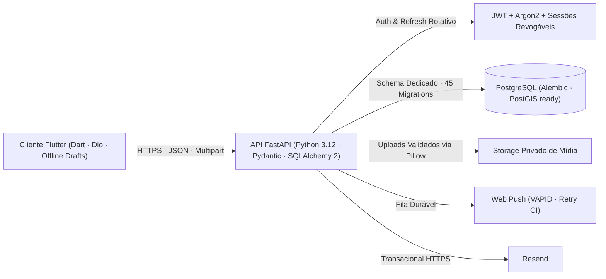

# GARONA

### Mais que carro. É projeto.

**Aplicativo autoral para documentar projetos automotivos, acompanhar evoluções e conectar a comunidade.**

`Flutter` · `FastAPI` · `PostgreSQL` · `Docker`

**Beta fechado** · **Código-fonte privado**

[Site oficial](https://garona.app) · [Instagram (@garona.app)](https://instagram.com/garona.app) · [Portfólio do autor](https://raullferreiraa.github.io/)

---

## O que é o Garona

O **Garona** nasce de um problema prático na cultura automotiva brasileira: projetos de carros evoluem por meses ou anos — entre compras de peças, manutenção, ajustes de suspensão, motor e encontros de rua —, mas registros em redes sociais comuns ou grupos de mensagem se perdem rapidamente no algoritmo e na rolagem infinita.

O aplicativo centraliza a trajetória real de cada veículo (do popular mexido ao antigo de garagem) em um único lugar:

| Pilar | Experiência no produto |
| --- | --- |
| **Minha garagem** | Ficha técnica completa (motor, câmbio, combustível, potência, suspensão e rodas), história do carro, galeria com legenda/recorte, foto de capa, rascunhos locais e proteção opcional de placas. |
| **Diário de evoluções** | Linha do tempo cronológica de manutenção, modificações e marcos (com ou sem fotos), vinculada às etapas **Planejadas**, **Em andamento** e **Concluídas** sem misturar planejamento com histórico publicado. |
| **Comunidade & encontros** | Perfis públicos, feed **Seguindo**, projetos salvos, equipes com cargos e garagem coletiva, conversas diretas/de equipe e encontros recorrentes por edição com mapa e notificações. |

> **Disponibilidade:** Este repositório público apresenta a arquitetura, as decisões de engenharia e os módulos do **Garona**. O código-fonte completo permanece em repositório privado enquanto o produto opera em **beta fechado**.

---

## Funcionalidades em operação

### 1. Garagem pessoal & ficha técnica
- Cadastro progressivo por modelo, ano, cor, apelido do projeto, proposta, fase atual e mês/ano de aquisição.
- História do veículo, estado inicial e modificações organizadas sem poluir a tela quando campos opcionais ficam vazios.
- Galeria de imagens com legenda, ordenação, escolha independente de capa e visualizador com zoom.
- Proteção ao sair de formulários quando há rascunhos ou alterações não salvas (isolados por conta e projeto no cliente).
- **Privacidade opcional de placa:** camada opcional no cliente combinando detecção local (OCR) e marcação/ajuste manual para preservar a privacidade da placa antes da publicação.

### 2. Etapas & diário de evoluções
- Planejamento dividido em etapas (`Planejadas`, `Em andamento`, `Concluídas`).
- Evoluções com título, descrição, data, categoria, quilometragem opcional, fotos, comentários, respostas e curtidas.
- Vínculo opcional entre etapa concluída e evolução publicada: editar ou reabrir uma etapa nunca apaga o histórico já registrado.

### 3. Descoberta, equipes e encontros
- Exploração e busca de projetos, perfis públicos, seguidores e projetos salvos.
- **Equipes:** perfil próprio, convites, pedidos de entrada, permissões por cargo (`dono`, `administrador`, `moderador`, `membro`), chat coletivo e seleção explícita do carro representante na garagem da equipe.
- **Encontros por edição:** comunidades permanentes com histórico de edições independentes, seleção de endereço e ponto no mapa, confirmação de presença individual ou da equipe, lista paginada de participantes, comunicados, lembretes opcionais e álbum/memórias.

---

## Arquitetura & Stack Técnica

O cliente consome uma API REST stateless com regras de negócio, autenticação, autorização e processamento de mídia aplicados integralmente no servidor.

### Tecnologias utilizadas

| Camada | Stack real do projeto |
| --- | --- |
| **Aplicativo** | Flutter, Dart, Dio, Phosphor Icons, `flutter_map`, `crop_your_image`, `geolocator`, `flutter_secure_storage`, Sembast (rascunhos locais) |
| **Backend & API** | Python 3.12, FastAPI, Pydantic Settings, SQLAlchemy 2, Alembic |
| **Banco de Dados** | PostgreSQL em schema dedicado, **45 migrations** versionadas |
| **Segurança & Auth** | JWT de curta duração, refresh tokens opacos rotativos (hash persistido em banco), senhas com Argon2, verificação server-side de propriedade/cargos |
| **Mídia & Processamento** | Pillow no backend (validação de assinatura/tamanho, correção EXIF, redimensionamento e re-encodamento seguro) + armazenamento em bucket privado servido sob controle da API |
| **Notificações & E-mail** | Fila durável de Web Push (`pywebpush` / VAPID) com retentativa agendada em GitHub Actions + envio transacional via Resend |
| **Infra & Entrega** | Render (Docker), Supabase (PostgreSQL + Storage privado), Cloudflare Pages + DNS, Zoho Mail |
| **Web & Marca** | Marca autoral e tipografia própria (`#0C100E`, `#D6EA78`, `Barlow Condensed` & `Manrope`), com landing page oficial em [`garona.app`](https://garona.app) |

---

## Decisões de Engenharia

- **Separação entre projeto, planejamento e diário:** entidades distintas garantem integridade do histórico do veículo mesmo quando etapas planejadas mudam de status ou são removidas.
- **Comunidades permanentes, edições isoladas:** permite cancelar ou remarcar uma data específica sem perder seguidores, identidade ou histórico de edições anteriores.
- **Permissões sempre verificadas na API:** cada mutação valida propriedade do carro, vínculo de conta ou cargo dentro da equipe no backend antes de tocar o banco.
- **Deduplicação e resiliência de rede:** chamadas seguras (`GET/HEAD`) toleram retentativa controlada em *cold start*, refresh tokens preservam rascunhos locais em indisponibilidades transitórias e publicações usam `operacao_id` para evitar duplicação por duplo clique.
- **Privacidade por padrão no armazenamento:** arquivos de imagem vivem em bucket privado no Supabase Storage e passam por verificação da API; informações sensíveis de conta não integram perfis públicos; notificações push externas não expõem mensagens ou fotos privadas na tela bloqueada.

---

## Qualidade & Validação Contínua

| Frente | Cobertura aplicada |
| --- | --- |
| **Backend (`pytest`)** | **54 arquivos de teste** cobrindo autenticação, rotação/revogação de sessão, permissões por recurso e cargo, regras de negócio, lembretes, Web Push, mídia privada e respostas HTTP. |
| **Mobile (`flutter_test`)** | **89 arquivos de teste** validando fluxos de tela, rascunhos isolados por conta/projeto, formulários com proteção de saída, redimensionamento/recorte de fotos e estados de erro/carregamento. |
| **CI & Banco (GitHub Actions)** | Execução automatizada de migrações Alembic em PostgreSQL real antes dos testes de API, análise estática (`dart analyze`), verificação de build e rotinas agendadas de Web Push/manutenção. |
| **Operação & Backups** | Script operacional próprio de backup/restauração testado em container isolado (tabelas do schema + objetos de mídia) antes de alterações críticas de esquema. |

---

## Origem do Projeto

O projeto começou em uma primeira versão web simples chamada **Garagem Digital** (Flask + MySQL), que validou a ideia inicial. Ao perceber que a experiência precisava estar no celular de quem acompanha e documenta o carro no dia a dia, toda a arquitetura, o modelo de dados, o backend e a interface foram reconstruídos do zero dando origem ao **Garona** — refletindo também a renomeação oficial deste repositório público (`garagem-digital` → `garona`). Atualmente opera em **beta fechado** enquanto evolui rumo à publicação oficial nas lojas (**Google Play** e **App Store**).

---

## Autor & Links

Projeto idealizado, arquitetado e desenvolvido por **Raul Ferreira** (Estudante de Ciência da Computação — UVV).

- **Site oficial:** [garona.app](https://garona.app)
- **Instagram:** [@garona.app](https://instagram.com/garona.app)
- **Portfólio:** [raullferreiraa.github.io](https://raullferreiraa.github.io/)
- **GitHub:** [github.com/raullferreiraa](https://github.com/raullferreiraa)
- **LinkedIn:** [linkedin.com/in/raullferreiraa](https://linkedin.com/in/raullferreiraa)

---

**GARONA · Mais que carro. É projeto.**

© 2026 Raul Ferreira

